<p align="center">
  
</p>

<p align="center">
  <a href="https://github.com/duceppemo/HashBrown/actions/workflows/ci.yml"></a>
  <a href="https://codecov.io/gh/duceppemo/HashBrown"></a>
  
  <a href="LICENSE"></a>
  <a href="https://github.com/duceppemo/HashBrown/wiki"></a>
</p>

HashBrown assembles bacterial genomes from whatever reads you have: Nanopore long reads, Illumina (or
Ion Torrent) short reads, or both. With long reads it assembles with Flye or Shasta and polishes with
Medaka; add short reads and they polish the assembly further (Polypolish, then pyPOLCA `--careful`); with
short reads alone it assembles with SKESA or SPAdes. Every run ends with QC — QUAST metrics, mapping QC
(samtools flagstat), read depth (mosdepth), assembly graphs, before/after polishing dot plots — and a
**per-sample HTML report** (with a PDF twin) showing the effect of every stage on the reads and the
assembly, plus optional modules for consensus QV (Merqury), species confirmation (mash + ANI),
completeness (CheckM2, BUSCO), typing (MLST, MOB-suite), AMR and virulence genes (AMRFinderPlus,
abricate), annotation (Bakta or PGAP) and contamination (ConFindr, GenomeScope2, blob plot) — each one
auto-detected and skipped with a hint when not installed.

Like its namesake — shredded potatoes pressed into one piece — HashBrown presses reads into one assembly.
It merges and supersedes [BGA](https://github.com/duceppemo/BGA) and
[BGA_short](https://github.com/duceppemo/BGA_short), which were split when Medaka's TensorFlow builds
conflicted with the short-read tools; one conda environment now covers everything.

<p align="center">
  
</p>

## Quick start

```bash
git clone https://github.com/duceppemo/HashBrown
cd HashBrown
conda env create -f environment.yml && conda activate HashBrown
pip install .

# Long reads only
hashbrown -l nanopore_fastq/ -o results/

# Hybrid: the short reads polish the long-read assemblies
hashbrown -l nanopore_fastq/ -s illumina_fastq/ -o results/

# Short reads only
hashbrown -s illumina_fastq/ -o results/ -a skesa
```

Each long-read fastq file is one sample. Short-read files pair on `_R1`/`_R2` in the name; a file without
either is a single-end sample. The sample name is everything before the first underscore, and in hybrid
mode the long- and short-read names must match. Rerunning the same command resumes where it stopped.

## Documentation

Everything else is in the [wiki](https://github.com/duceppemo/HashBrown/wiki), whose sources are maintained
in [`docs/wiki`](docs/wiki):

- [Installation](https://github.com/duceppemo/HashBrown/wiki/Installation) — conda, pip, troubleshooting
- [Usage](https://github.com/duceppemo/HashBrown/wiki/Usage) — inputs, options, resuming, performance
- [Methods](https://github.com/duceppemo/HashBrown/wiki/Methods) — what each step runs and why
- [Outputs](https://github.com/duceppemo/HashBrown/wiki/Outputs) — folders and files
- [Validation](https://github.com/duceppemo/HashBrown/wiki/Validation) — benchmarking the polisher
  combinations against a gold standard
- [FAQ](https://github.com/duceppemo/HashBrown/wiki/FAQ) — troubleshooting
- [Development](https://github.com/duceppemo/HashBrown/wiki/Development) — tests, CI, releases

## Citation

If HashBrown is useful in your work, please cite this repository (see [`CITATION.cff`](CITATION.cff)) and
the programs it runs: Flye or Shasta, Medaka, Porechop, Filtlong, SKESA or SPAdes, fastp, Polypolish,
pyPOLCA, BWA, minimap2, SAMtools, QUAST, mosdepth, MUMmer and Bandage
([references](https://github.com/duceppemo/HashBrown/wiki/Methods#references)).

## License

[MIT](LICENSE)
